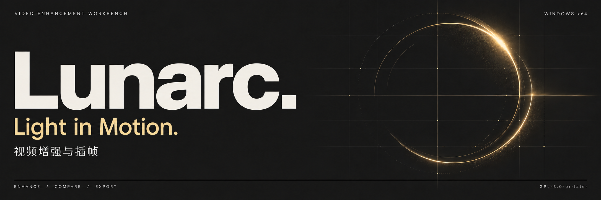
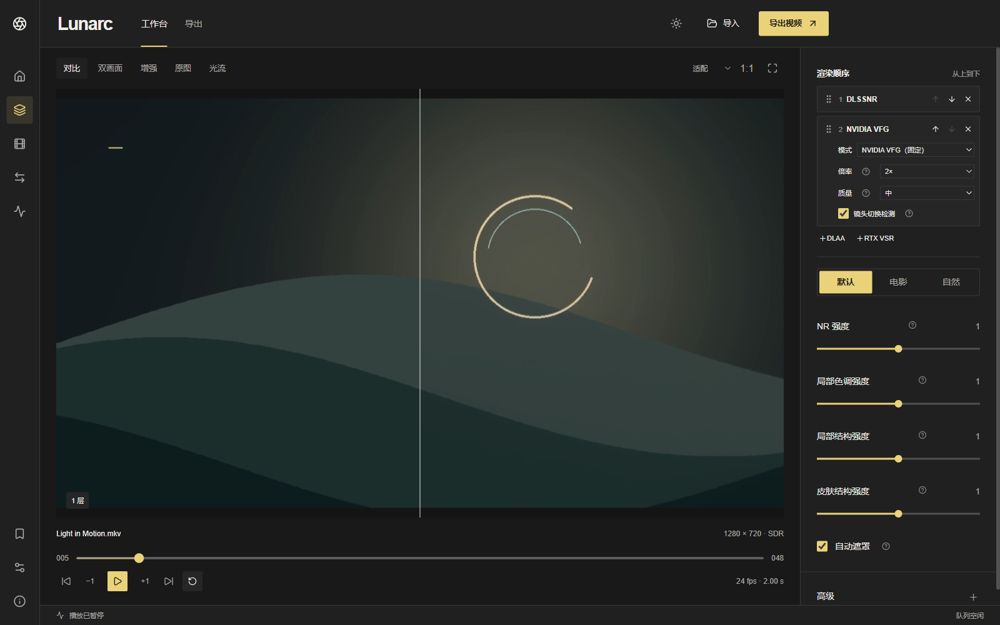

[简体中文](README.md) · **English** · [日本語](README.ja.md) · [Русский](README.ru.md)

# Lunarc — DLSS 5 Video & Image Enhancement

<p> &nbsp; <strong>LUNARC</strong></p>



**Windows x64** · **GPL-3.0-or-later**

Lunarc brings DLSS 5 (DLSS5 / DLSSNR) neural rendering to video and image enhancement on Windows, with DLAA, RTX VSR upscaling, NVIDIA VFG frame interpolation, TrueHDR SDR-to-HDR conversion and dedicated image upscaling.

[Download](https://github.com/Yukikaze1945/Lunarc-DLSS5/releases/latest) / [User guide](docs/en/user-guide.md) / [Website](https://lunarc-workbench.defaddg-9590.chatgpt.site/en/)

This page describes the current source. Check release notes for features included in a particular installer.

## 01 / Workbench



The screenshot uses demonstration media; it may show an earlier interface language.

| Processing chain | Comparison | Export queue |
| --- | --- | --- |
| Reorder cards and disable stages without losing their settings. | Inspect original, processed, split and side-by-side views. | Choose output size, encoding and destination; manage queued tasks. |

## 02 / Features

| Feature | Scope |
| --- | --- |
| DLSSNR | One, two or three layers with independent controls. Sequential processing or experimental multiscale data-consistency fusion. |
| DLAA | Runtime model presets; support depends on the installed library. |
| RTX VSR | Multiple reorderable stages, quality levels and strength. Upscale by factor or target resolution; available modes depend on runtime and GPU. |
| Optical flow | NVIDIA NVOF, AMD FidelityFX Optical Flow and RAFT-Large. Configurable RAFT analysis size and iterations. |
| NVIDIA VFG | Fixed multiplier or target frame rate, with scene-cut detection. Export only; 5×–8× is experimental. |
| Color and TrueHDR | SDR 8/10-bit and experimental HDR10. TrueHDR controls contrast, saturation, middle gray and peak luminance, with AI debanding. External NVIDIA components required. |
| Images | IllustrationJaNai V3 and AnimeSharp V4 integration; separate model weights. PNG, JPEG, WebP, AVIF and HEIC export subject to encoder availability. Image output currently uses SDR. |
| Presets and ranges | Save/apply presets, inspect changes from defaults, collapse cards, select an export range and pre-render it. Matching completed cache ranges appear green. |
| Runtimes | Download/import DLSSNR versions, verify hashes/signatures and select a cached version. Other NVIDIA components retain their own requirements. |

Native P010 export supports **HEVC Main10** and **AV1 Main, 10-bit** for SDR 10-bit or HDR10 in **MKV**. Unsupported combinations are rejected rather than silently changed. Audio, subtitles, chapters, attachments and metadata retention depends on output options and container support.

## 03 / Install

1. Download the Windows x64 installer from [Releases](https://github.com/Yukikaze1945/Lunarc-DLSS5/releases/latest).
2. On first launch, install the **base runtime** and **video processing components**.
3. Open **Runtime & diagnostics → DLSSNR runtime**, download or import a library you are entitled to use, then select it.
4. Import media and enable the stages you need. See the [user guide](docs/en/user-guide.md#quickstart).

The installer does not require a separate Python, Node.js or CUDA Toolkit installation. **RAFT and dedicated image models** need optional PyTorch/CUDA components and model weights. Native NVIDIA/AMD flow and GPU decoding/encoding do not need PyTorch. Compatible installed components are retained during updates.

### Requirements and limits

- Windows x64 and a compatible NVIDIA GPU/driver for the selected features.
- NVIDIA effect libraries are separate dependencies; their licenses still apply.
- Initial component setup requires internet. AI runtime downloads can be several GB.
- Native Windows workbench video preview uses FP16/scRGB for HDR when Windows HDR is enabled; otherwise it maps to SDR. File comparison uses SDR mapping. Neither is a calibrated HDR reference.
- HDR10, multiscale fusion and VFG 5×–8× are experimental. Speed depends on hardware, source and settings. No general real-time performance guarantee is made.

## 04 / Run from source

```powershell
git clone https://github.com/Yukikaze1945/Lunarc-DLSS5.git
cd Lunarc-DLSS5
```

Prepare Python 3.10+, Node.js 22.18+, FFmpeg/FFprobe, Visual Studio C++ Build Tools and Windows SDK. Native bridges also require the relevant SDKs and FFmpeg development files. Set `DLSS_SDK_DIR` and `FFMPEG_SDK_DIR`, build with `native\build_all.bat`, then launch **`run_gui.bat`** from the root.

Follow the [source setup guide, Chinese](docs/getting-started.md) for dependency commands and native build details. It includes extra AMD flow requirements. Do not substitute an ordinary DLSS super-resolution DLL for `nvngx_dlssnr.dll`.

## 05 / Documentation

- [Detailed user guide](docs/en/user-guide.md): processing order, models, color, ranges, presets, images, export and troubleshooting.
- [Installation, Chinese](docs/installing.md) · [NVIDIA runtime setup, Chinese](docs/native-runtime.md) · [DLSSNR versions, Chinese](docs/dlssnr-runtime.md).
- [GPU preview, Chinese](docs/native-hdr-preview.md) · [Multiscale solver, Chinese](docs/multiscale-solver.md) · [Validation records, Chinese](docs/public-release.md).
- [Language implementation and translation maintenance](docs/localization.md).

## 06 / License

Lunarc is licensed under **GPL-3.0-or-later**. See [LICENSE](LICENSE) and [third-party notices](THIRD_PARTY_NOTICES.md). The project license does not grant rights to download or redistribute proprietary NVIDIA libraries.
