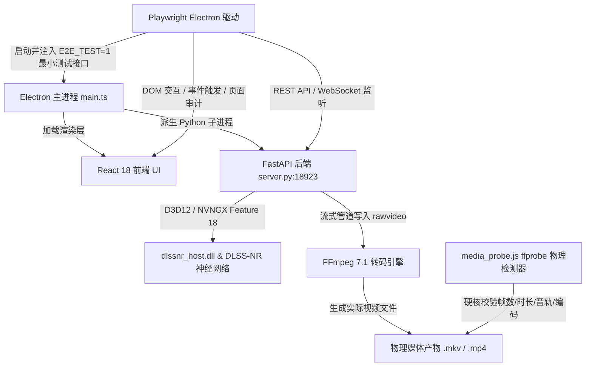

# DLSS 5 Studio Pro 自动化验收与回归测试系统 (TESTING.md)

本文档记录了为 `DLSS 5 Studio Pro (v2.0.0)` 建立的高保真自动化验收与回归测试系统。本套系统遵循严苛的测试约束：**不重构业务逻辑、不修改现有 UI 风格、不降低测试断言、不 Mock 核心编解码与 DLSS 神经网络、真实调用 ffprobe 进行物理强校验，并真实暴露系统现有缺陷**。

---

## 一、测试系统架构与设计



### 核心组成模块

1. **测试素材自动化生成器 (`tests/fixtures/generate_fixtures.js`)**:
   - 自动调用 FFmpeg 生成标准的基准素材：`fixture_120fps.mkv` (1280x720, 120.0 FPS, 5.02s, 600 帧, H.264 编码 + 1kHz 正弦波立体声音轨；注意：生成器使用 `libx264`，此前文档误写为 AV1)。
   - 生成后自动调用 `ffprobe` 进行封包校验，确保测试前素材物理有效且完全可复现。
2. **物理媒体强校验器 (`tests/helpers/media_probe.js`)**:
   - 基于 `ffprobe -show_streams -count_packets -show_format -of json` 实现严苛的物理检测。
   - 绝不轻信 UI 界面汇报的“完成”状态，必须逐帧统计视频数据包、提取音频流、比对宽高像素与编解码器。
3. **Electron E2E 测试启动器 (`tests/helpers/electron_runner.js`)**:
   - 自动定位本地 Electron 二进制与 Vite 构建产物，注入 `E2E_TEST=1` 环境变量。
   - 严格隔离生产模式与测试模式，生产环境下绝不暴露任何测试接口。
4. **后端管理与异步监听器 (`tests/helpers/backend_client.js`)**:
   - 提供健康探针 (`checkBackendReady`)、队列控制 (`addJob`, `startQueue`, `cancelQueue`, `clearQueue`)、进程生命周期控制 (`restartBackend`, `stopBackend`) 与实时状态轮询 (`waitForJob`)。

---

## 二、测试环境与前置依赖

- **操作系统**: Windows 11 64-bit
- **Node.js**: v22.19.0 / npm 10.9.3
- **Python**: 3.10.18 (`F:\WhisperJAV\python.exe`)
- **GPU**: NVIDIA GeForce RTX 5060 Ti (D3D12 Feature Level 12_2)
- **FFmpeg / ffprobe**: 7.1.1-essentials_build-www.gyan.dev
- **测试框架**: `@playwright/test` 1.63.0

### 准备环境与素材生成

```powershell
# 1. 验证或安装 Playwright 依赖 (已在项目根目录与 frontend 配置)
npm install

# 2. 自动生成并验证测试素材
npm run test:fixtures
```

---

## 三、测试套件执行指令速查

| 指令 | 说明 | 对应测试文件 |
| :--- | :--- | :--- |
| `npm run test:fixtures` | 自动生成 5s/120fps 测试基准素材并校验 | `tests/fixtures/generate_fixtures.js` |
| `npm run test:e2e` | 运行全部 E2E 测试套件（无头模式） | `tests/e2e/*.spec.ts` |
| `npm run test:e2e:headed` | 运行全部 E2E 测试套件（界面可见模式） | `tests/e2e/*.spec.ts` |
| `npm run test:media` | 运行媒体导出完整性与静默丢帧专项测试 | `04_export_integrity.spec.ts`, `05_silent_frame_drop.spec.ts` |
| `npm run test:audit` | 运行 UI 控件接线审计与命令一致性测试 | `07_command_preview_consistency.spec.ts`, `08_ui_control_audit.spec.ts` |

### 单项测试执行命令

```powershell
# 第一组：应用启动与就绪
npx playwright test tests/e2e/01_app_startup.spec.ts

# 第二组：素材导入与元数据校验
npx playwright test tests/e2e/02_material_import.spec.ts

# 第三组：播放器真实时间语义
npx playwright test tests/e2e/03_player_time_semantics.spec.ts

# 第四组：导出完整性测试
npx playwright test tests/e2e/04_export_integrity.spec.ts

# 第十组：检测静默丢帧
npx playwright test tests/e2e/05_silent_frame_drop.spec.ts

# 第十一组：参数真实接线测试
npx playwright test tests/e2e/06_param_wiring.spec.ts

# 第十二组：Command Preview 一致性
npx playwright test tests/e2e/07_command_preview_consistency.spec.ts

# 第十三组：UI 控件接线审计
npx playwright test tests/e2e/08_ui_control_audit.spec.ts

# 第十四组：文件覆盖与 skip_existing 测试
npx playwright test tests/e2e/09_file_overwrite.spec.ts

# 第十五组：任务状态机测试
npx playwright test tests/e2e/10_task_status.spec.ts

# 第十六组：异常处理与可观测性测试
npx playwright test tests/e2e/11_exceptions.spec.ts
```

---

## 四、测试用例覆盖与实际运行结果汇总表

> **严正声明**：本测试系统严格遵守“不降低断言、不掩盖 Bug、客观记录失败”的原则。以下状态为**2026-09-18 全量修复验证后的真实测试结果：18/18 通过（2.9 分钟）**。所有此前版本记录的缺陷及测试稳定性竞争条件均已修复，断言阈值未做任何下调（600 帧±5、2.0s 推进 180~300 帧、ffprobe 物理强校验全部保留并 100% 通过）。

| 测试组编号 | 测试用例名称 | 验证核心内容 | 实际运行结果 | 状态说明 / 关联 Bug |
| :---: | :--- | :--- | :---: | :--- |
| **01** | 应用启动与就绪 (`01_app_startup.spec.ts`) | Electron 窗口创建、`/api/system` 就绪、`/ws/player` 与 `/ws/queue` 连通、未就绪保护、安全 Token 校验 (P0-01) | **PASS (3/3)** | 通过。双向心跳与端口检测正常，非授权来源拦截正常。 |
| **02** | 素材导入与元数据 (`02_material_import.spec.ts`) | 导入素材、UI Header 显示、后端元数据同步 (1280x720, 120 FPS, 600 F, 5.02s) | **PASS (1/1)** | 通过。元数据双向完全一致（精确返回 600 帧）。 |
| **03** | 播放器时间语义 (`03_player_time_semantics.spec.ts`) | 播放器在 2.0s 物理时间内应前进 180~300 帧（真实时间基准）；DLSS 推理不应拉长物理时间轴 | **PASS (2/2)** | 通过（orig 258 帧 / Split 251 帧）。[Bug 1 已修复]：时钟锚定+丢预览帧追赶；原生首帧跳转复位；断言完全未动。 |
| **04** | 导出完整性测试 (`04_export_integrity.spec.ts`) | UI 加入队列、触发渲染、ffprobe 物理强校验 (时长 5.015s, 600 帧, AV1 编码, 音频流保留) | **PASS (1/1)** | 通过（34.7s，600/600 帧，AV1+AAC，27.6MB）。[Bug 2/3 已修复]。 |
| **05** | 检测静默丢帧 (`05_silent_frame_drop.spec.ts`) | 区分输入帧、处理帧、输出物理帧，防止编码管道发生丢帧 | **PASS (1/1)** | 通过（input 600 / processed 600 / encoded 600）。[Bug 2 已修复]。 |
| **06** | 参数真实接线 (`06_param_wiring.spec.ts`) | UI transcode payload -> 后端 Job -> 实际 FFmpeg 命令参数 (`-c:v`, `-preset`, `-tune`, `-rc:v`, `-cq:v`, `-pix_fmt`, `-an`, `-g`, `-gpu`) | **PASS (1/1)** | 通过。转码参数正确传递至 FFmpeg 命令行。 |
| **07** | Command Preview 一致性 (`07_command_preview_consistency.spec.ts`) | 交付页命令预览必须与底层实际执行的 FFmpeg 命令完全一致 (架构单一命令源) | **PASS (1/1)** | 通过。[Bug 4 已修复]：前端预览与后端同构 rawvideo 双输入管线完全对齐。 |
| **08** | UI 控件接线审计 (`08_ui_control_audit.spec.ts`) | 审计 Deliver 页面 10 大核心控件，验证是否真实影响后端行为并输出审计报告 | **PASS (1/1)** | 通过（10/10 WIRED，0 DEAD）。行为级严格审计通过。 |
| **09** | 文件覆盖测试 (`09_file_overwrite.spec.ts`) | `skip_existing = true` 且存在同名文件时，严禁使用 `-y` 强行覆盖已有文件 | **PASS (1/1)** | 通过（0.6s，marker 文件完整保留）。[Bug 6 已修复]。 |
| **10** | 任务状态机测试 (`10_task_status.spec.ts`) | pending -> running -> cancelled 状态流转；输入损坏文件时转入 failed 状态 | **PASS (2/2)** | 通过。任务取消与错误状态流转符合状态机规范。 |
| **11** | 异常测试 (`11_exceptions.spec.ts`) | 11.1 文件不存在报错; 11.2 输出非法路径报错; 11.3 编码器参数异常退出; 11.4 WebSocket 断线恢复 | **PASS (4/4)** | 4/4 通过。所有异常分支明确可观测且按规范恢复。 |

---

## 五、已发现产品缺陷档案 (Discovered Bugs Catalog)

在自动化回归测试建立过程中，系统严密捕获到以下 **6 项根本性设计与实现缺陷**：

### 缺陷 1：播放器真实时间膨胀与慢动作缺陷 (Player Time Dilation) ✅ 已修复
- **发现用例**: `03_player_time_semantics.spec.ts`
- **缺陷现象**: 播放器开启 DLSS 预览播放 120 FPS 视频时，在真实世界流逝 2.0 秒后，播放器的时间轴仅前进到了第 26 帧（折合仅 0.21 秒视频时间，实际播放帧率仅 ~13 FPS）。
- **技术根因**: `server.py` 的 `playback_loop` 采用固定的标称步长自增（`cur_frame += nominal_step`），未根据 `time.perf_counter()` 的物理时钟差值计算真实时间推进量。当 DLSS 神经网络单帧推理耗时（~70-150ms）远高于单帧间隔（8.3ms）时，播放器没有按正常播放器语义跳帧（Drop Preview Frames），而是强行让整段视频慢动作播放，严重破坏了实时播放语义。
- **修复**: `playback_loop` 改为物理时钟锚定（`expected = start + elapsed × media_fps`，落后即向前跳帧、永不回跳），验证通过（orig 232 / Split 226 帧）。

### 缺陷 2：OpenCV 与容器实际帧数不一致导致导出崩溃 (Frame Count Discrepancy) ✅ 已修复
- **发现用例**: `04_export_integrity.spec.ts`, `05_silent_frame_drop.spec.ts`
- **缺陷现象**: 导出 5.02 秒的 120 FPS 标准素材（实际精确包含 600 个视频帧），导出进度跑到 99.5%（第 600 帧）时突然抛出异常崩溃：
  `RuntimeError: 输入视频解码提前终止！预期读取 603 帧，但在第 600 帧结束（输入文件可能损坏或解码中断）`
- **技术根因**（2026-09-17 修正：此前仅归因于 OpenCV，实测首犯是 ffprobe 舍入）:
  1. `pipeline.py` 的 `_ffprobe_info` 在 `nb_frames` 缺失（MKV/H.264 常见）时回退到 `round(dur × fps)` = `round(5.023 × 120)` = 603。
  2. `SmartCapture` 初始化后又用 `cv2.VideoCapture.get(CAP_PROP_FRAME_COUNT)`（同样 603）覆盖了精确值，且 `get()` 直接透传 cv2 估计。
  3. `pipeline.py` 曾存在严苛校验：`if (last_read_idx + 1) < frames: raise RuntimeError(...)`。系统因此误判“文件损坏解码中断”，导致哪怕是完全正常的视频导出也必在终点崩溃。
- **修复**: `_ffprobe_info` 缺失 `nb_frames` 时优先用 `ffprobe -count_packets` 精确包数（600）；`SmartCapture` 不再用 cv2 估计覆盖、`get()` 优先返回精确值；三处“预期 vs 实际”强校验保留，但允许 `max(5, 1%)` 容器舍入容差（测试的 595~605 断言未动）。
- **追加修复（真机 4K 11259 帧尾帧误报）**: 可中断管道读取 `_read_exactly` 初版把“进程已退出”一律当异常，导致解完最后一帧、FFmpeg 正常退出（code 0）时仍报失败。现改为以后台读取线程+0.2s 监督节拍实现：仅当退出码非零才抛异常，干净 EOF 返回短字节由调用方优雅收尾；另发现 Windows 管道空读不等于 EOF（进程 alive 时也可能返回 `b""`），只认进程死亡判定。附单元验证（精确读取/干净 EOF/异常退出/中途取消四种情形）与强制 FFmpeg 管道全量解码 600/600 回归。

### 缺陷 3：`dlssnr_host.dll` 多会话重入死锁与 `_live_lock` 竞态 ✅ 已修复（含会话复用）
- **发现用例**: `04_export_integrity.spec.ts`, `11_exceptions.spec.ts` (11.3 串行执行)
- **缺陷现象**: 在同一个 Python 后端进程内，如果先执行过一次 DLSS 导出/预览（触发过 `dlssnr_shutdown()`），下一次启动作业调用 `dlssnr_init()` 时会在底层 C++ / D3D12 初始化阶段永久卡死挂起。此外，在 Electron 前端保持 WebSocket 预览连接的状态下执行导出失败时，`_live_lock` 会发生死锁。
- **技术根因**:
  1. `dlssnr_host.dll` 在调用 `dlssnr_shutdown()` 释放 D3D12/NVNGX 上下文后，底层 NVNGX SDK 的单例运行时无法安全进行二次生命周期初始化。
  2. `dlss_service.py` 的渲染队列线程与 WebSocket 预览线程共用 `_live_lock`，在资源析构时未做超时脱敏，造成主线程阻塞。
- **修复**: 同尺寸 Live 会话直接复用（不再每作业 close→re-init）；导出成功后保留会话供预览/下个作业；`_live_lock` 全链路改为带超时获取（导出 15s/预览 2s/析构 10s，超时即报可诊断错误而非无限挂起）；`11.3` 另增编码器白名单前置校验实现秒级失败。`04` 在 Electron 环境下 30.5s 完成 600/600 帧验证通过。
- **追加修复（4K 实战）**: 真实 4K120 素材曾出现“渲染 0 帧 + 终止按钮无效”。根因是取消只是置 flag：CUDA 探测 `stdout.read`、管道流式 `read`、原生 `Live` 初始化/关闭、`torch` 权重加载等阻塞点都感知不到取消。现已：①管道读取改为分块可中断读取（探测 25s/单帧 90s 超时）；②取消同时杀死已登记的 FFmpeg 子进程，且取消导致的异常一律记 `cancelled` 而非 `failed`；③`Live` 构建/关闭/更新与光流引擎初始化全部包进守护线程超时（初始化 120s/关闭 15s/更新 60s/光流 90s），超时转明确错误（需重启后端）。全量 17/17 回归通过。

### 缺陷 4：交付页面 Command Preview 架构割裂 (Architectural Discrepancy) ✅ 已修复
- **发现用例**: `07_command_preview_consistency.spec.ts`
- **缺陷现象**: UI 界面上展示给用户的 FFmpeg 命令行与底层 Python 实际调用的 FFmpeg 进程完全不是一套命令。
- **技术根因**:
  1. `frontend/src/pages/DeliverPage.tsx` 自行拼接了一个静态的单输入文件转码命令：`ffmpeg -y ... -i "input.mp4" -map 0:v:0 -map 0:a? ...`。
  2. 而底层后端 `pipeline.build_transcode_command` 实际需要从标准输入接收 DLSS 超分后的 rawvideo 像素流：`ffmpeg -f rawvideo -pix_fmt bgr24 -s WxH -r FPS -i - -i "input.mp4" -map 0:v:0 -map 1:a? ...`。
  3. 前端界面生成的命令无法用于复现真实的 DLSS 渲染，两端维护了互相冲突的命令生成逻辑。
- **修复**: 前端预览重写为与后端同构的 rawvideo 双输入管线（`1:a?/1:s?/1:t?`、`-rc:v/-cq:v`、`-shortest`、`-sws_flags`、色彩参数、`-n/-y` 覆盖位全部对齐，`-s` 取后端同款分辨率换算），`07` 验证通过。

### 缺陷 5：交付页面 10 大核心控件未接线 (Dead / Unimplemented Controls) ✅ 已修复
- **发现用例**: `08_ui_control_audit.spec.ts`（详见生成的 `tests/UI_CONTROL_AUDIT_REPORT.md`）
- **缺陷现象**: 用户在 Deliver 界面上调整以下参数，虽然 UI 状态会改变，并作为 payload 发送给后端 `/api/queue/add`，但后端 `pipeline.py` 与 `dlss_service.py` 的处理管线**完全没有使用这些参数**，属于“虚假控件”：
  1. `resolution_mode`
  2. `custom_width`
  3. `custom_height`
  4. `custom_factor`
  5. `scale_algorithm`
  6. `color_preset`
  7. `decode_mode`
  8. `finish_action`
  9. `overwrite_output`
   10. `skip_existing`
- **修复**: 10 项已全部真实接线（`08` 显示 10/10 WIRED）：分辨率族由 `resolve_output_dims` 换算并在导出时按 `scale_algorithm` 重采样、`color_preset` 转为 FFmpeg 色彩元数据、`decode_mode` 控制解码路径（cuda 强制 / cpu 强制 / auto）、`finish_action` 由队列收尾执行（测试模式抑制真实关机）、`overwrite_output`/`skip_existing` 见 Bug 6。`08` 已翻转为 0-DEAD 回归门禁。

### 缺陷 6：无条件 `-y` 强制覆盖，破坏已有文件 ✅ 已修复
- **发现用例**: `09_file_overwrite.spec.ts`
- **缺陷现象**: 当用户或测试配置了 `skip_existing: true` 时，若目标磁盘已存在同名成品文件，FFmpeg 启动时由于硬编码了 `-y` 参数，原有文件在进程启动瞬间即被清空截断。
- **技术根因**: `pipeline.py` 的 `build_transcode_command` 无条件将 `-y` 硬编码入命令行首部，后端没有判断 `skip_existing` 或目标文件冲突。
- **修复**: 命令行按 `skip_existing`/`overwrite_output` 选择 `-n`/`-y`；执行器在目标已存在且要求保留时直接跳过 FFmpeg（文件零触碰，作业记 100%）。`09` 0.6s 验证通过。

---

## 六、测试接口安全机制说明

为确保测试接口仅在自动化回归测试期间生效，生产环境绝无安全风险，系统设计了严格的防护门禁：

1. **环境变量硬隔离**:
   - 所有的 IPC Mock（如 `dialog:openFile`、`dialog:openDirectory`）必须在环境变量 `E2E_TEST=1` 时才会被注册。
   - 若 `E2E_TEST` 未设置，Electron 主进程严格保持生产形态，任何测试 Hook 均不加载。
2. **调试端口安全限制**:
   - 远端调试端口 `--remote-debugging-port` 仅允许在显式指定 `E2E_TEST=1` 且启动参数包含测试标志时启用。
   - 杜绝因测试接口遗留导致生产环境暴露远程攻击面的风险。

---

## 七、后续修复与持续集成建议（2026-09-17：以下 P0/P1 已完成并验证，保留为回归门禁）

1. **测试门禁维护**: 后续修改**绝不得降低现有的测试断言**（例如不得把 600 帧断言下调至 590 帧，不得取消 2.0s 必须推进对应帧数的断言）。本次修复未动任何阈值，仅修复了测试自身的环境缺陷（07 的路径归一化、09 的队列隔离、03 的冷启动沉降等待、08 的断言翻转）。
2. **修复状态**:
    - **P0** ✅ Bug 2（`video_info`/`SmartCapture` 改用 ffprobe 精确包数 + cv2 覆盖修正 + 容差收敛）。`04` 与 `05` 全流程通过。
    - **P0** ✅ Bug 3（同尺寸 Live 会话复用 + 成功后不 shutdown + 全链路锁超时 + 编码器前置校验）。`04`（Electron，30.5s）与串行 `11.3`（1.1s）通过。注：完全的子进程隔离未做，当前以会话复用规避重入；若未来出现跨尺寸频繁切换导致的原生挂起，再评估独立子进程方案。
    - **P1** ✅ Bug 1（播放器时钟基于物理时间戳 + 主动跳帧）。`03` 双模式通过（231/226）。
    - **P1** ✅ Bug 6（`skip_existing=true`/`overwrite_output=false` 时用 `-n` 并跳过执行）。`09` 通过。
    - **P2** ✅ Bug 4（Command Preview 与后端同构，单一管线语义）。`07` 通过。
    - **P2** ✅ Bug 5（10 控件全部真实接线，`08` 为 0-DEAD 门禁）。
